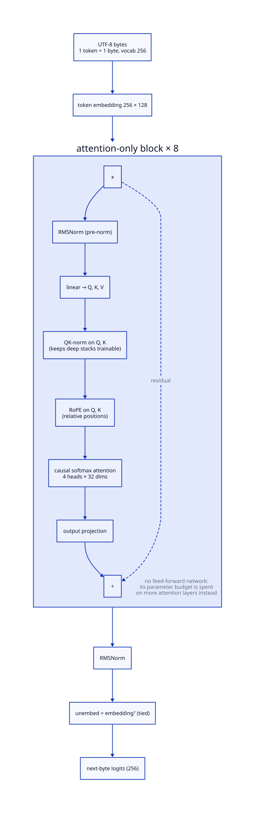

# Wren

[](https://github.com/stroblme/wren/actions/workflows/ci.yml)
[](https://stroblme.github.io/wren)
[](https://pypi.org/project/wren/)
[](LICENSE)

Wren is a tiny foundation model that can run with on a CPU and less than 1GB of RAM (inference).
Designed to be called to perform actions which require RAG knowledge, as e.g. in facility automation, where highly customized and specialized devices are located.

It should be capable of making tool calls and reading values like

> Setup a scene for dinner
>> *activates lights in the living room and plays some ambient music*

> Coming home in 10m
>> *turns on the lights in 10m and heats up the house*

> What is the current power consumption
>> *1234W*

On the other hand, Wren should also be capable of learning behaviors, to make tool calls autonomously.
E.g. the input would then be the state of the system, based on which wren would make a prediction about the next state.

Wren is part of the [Fluksio](https://fluskio.com) automation software.

## Usage

Inference reads a prompt from the arguments or stdin and writes the continuation to stdout:

```sh
uv run wren "turn on the lights in the kitchen"
echo "what is the temperature in the office" | uv run wren -n 40
```

The trained weights ship inside the package (`wren/weights.npz`), so no training is needed to run the model.
Retraining overwrites them:

```sh
uv run wren --train             # built-in demo corpus
uv run wren --train corpus.txt  # any UTF-8 text file
uv run wren --train --steps 2000 --lr 3e-3   # one flag per knob
uv run wren --train --dim 256 --n-layers 8   # the model's shape included
```

Training runs on the project-local [fluksio](https://fluskio.com) engine
(`uv run fluksio serve`), which records what every run was given — the model's
shape, the training parameters, the loss curve, the resulting parameter count
— and the weights it produced, which `--train` downloads into the package.
`fluksio export runs --flow wren_train` is the history. Each knob defaults to
`wren.train.DEFAULTS`, which is `Config` plus `train()`'s signature and the
only place those numbers are written down.

## Architecture

Wren is an attention-only byte-level decoder (a "Simple Attention Network"): standard transformer blocks minus the feed-forward MLPs, with the saved parameters spent on more attention layers.
QK-normalization is what keeps the deep attention-only stack trainable, and RoPE encodes relative positions.
Attention-only models are weak at knowledge stored in weights but strong at context-grounded answers — a deliberate fit, since Wren receives its knowledge via RAG/context at runtime.



Diagram source: [doc/architecture.d2](doc/architecture.d2), rendered with `d2 doc/architecture.d2 doc/architecture.svg`.

## Benchmark

Reference point (2026-09-01) against [needle 2](https://cactuscompute.com/needle), the smallest published tool-calling model, on [google/mobile-actions](https://huggingface.co/datasets/google/mobile-actions): all 961 eval rows, ordered strict exact match (needle's protocol), greedy decoding. Wren rows are fluksio `s7_bottleneck` runs (corpus=mobile, 8000 steps, muon 3e-3, seed 0; runs `1788289190357-de0baeab` and `1788122526556-cb31a992`), trained on the 8,693-row train split plus ~2% synthetic negatives.

| model | params | weights | peak RAM | CPU decode | exact match | arg F1 |
|---|---|---|---|---|---|---|
| Wren, dim 128 × 36 layers | 2.40M | 9.7 MB fp32 | 988 MB¹ | 8.9 B/s¹ | 34.8% | 44.3% |
| Wren, dim 256 × 8 layers | 2.17M | 8.7 MB fp32 | 877 MB¹ | 25.3 B/s¹ | 30.6% | 40.1% |
| Wren, dim 256 × 8, ternary QAT | 2.17M | 0.80 MB packed³ | —³ | —³ | 34.8% | 45.1% |
| needle 2 | 45M | 14 MB (2-bit) | 28 MB | 500+ tok/s² | 63.7% | — |

¹ Single-stream greedy decode, prompt processing included, through the JAX CPU runtime on x86. RAM is dominated by that runtime, not the ~10 MB of weights: the memory/speed gap against needle is mostly engine (dependency-free C++, 2-bit quantization-aware weights), not model size. At matched parameter count, depth is the CPU latency axis — 8 layers decode ~3× faster than 36.

² Raspberry Pi 5, from the needle 2 page.

³ BitNet-style quantization-aware training (`dev/s8_state_quant`, run `1788349172553-e26a05ad`): attention weights at 2 bits, embedding/norms fp32 — the theoretical shipped size; no packed runtime exists yet, so RAM and speed are not measured. Task metrics match or beat the fp32 arm at the same shape and budget.

Protocol differences that favor needle: tool schemas in context with retrieval, grammar-constrained decoding, and a 115B-token pretraining corpus. Wren holds the 7-function surface in its weights (implicit-tool mode) and decodes freely after task-only training.

## Related Research

- [A Controlled Study of Attention-Only Transformers](https://arxiv.org/abs/2607.18363)

## Toolstack

Core engine

- jax
- flax
- optax

Package management, code quality, testing and documentation

- uv
- ruff
- ty
- pytest
- zensical

