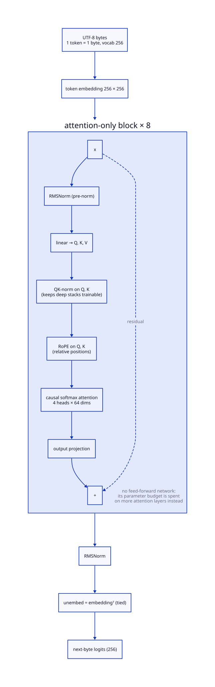

# Wren

Wren is a small attention-only model that reads bytes and turns a short
command into calls on a fixed set of targets, on a CPU. You list the things a
command may act on, such as lights, a heating setpoint or a pump, with their
current values. Given "close the awning in 10 minutes", Wren answers
`set(canopy, DOWN) in 10m`, with a confidence for each call. A model answers
in about 0.05 s, needs only NumPy and packs into about half a megabyte.

Wren is meant for the commands people give again and again, on one
installation. Each installation trains its own model, which takes about 40
minutes on a CPU. Questions and anything else Wren is unsure of go to a
larger language model that you run beside it. Wren is part of the
[Fluksio](https://fluksio.com) automation software, but the library stands on
its own.

## Quick start

```sh
pip install git+https://github.com/stroblme/wren
wren "turn on the kitchen light"
# >> set(kitchen_light, true)  1.00
```

The `wren` package on PyPI is an unrelated project.

The package ships a demo model trained on a home with 20 targets
(`wren/home.json`), which the command line uses by default. For your own
installation, describe its targets in a JSON file, add examples and tests,
and train:

```python
import json

from wren import Target, act, load_pack
from wren.train import fit  # needs the train extra

home = json.load(open("home.json"))
targets = [Target(**t) for t in home["targets"]]
fit(targets, out="home.bin", examples=home["examples"], tests=home["tests"])

model = load_pack("home.bin")
calls = act("close the awning in 10 minutes", targets, model=model)
applied = [c for c in calls if c.confidence >= model["meta"]["threshold"]]
```

Apply the calls at or above the model's threshold and hand the command on
otherwise. The [How-to](guide.md) explains each step.

## How it works

Wren is an attention-only byte-level decoder: transformer blocks without the
feed-forward layers, with the saved parameters spent on more attention
layers. Such models are weak at facts stored in their weights and good at
copying from their context, which suits a model that gets the targets and
their values in its prompt. The weights are ternary and packed for the NumPy
and C runtimes.



The studies behind these choices are in the repository's
[`dev/`](https://github.com/stroblme/wren/tree/main/dev) folder, each with its
question, findings and how to reproduce it.
